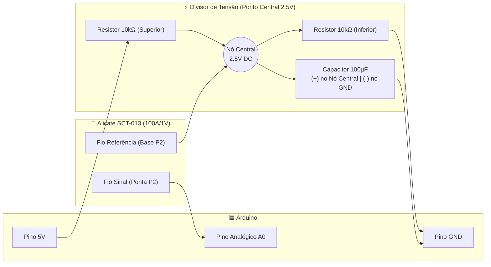

# ⚡ Monitor de Consumo Elétrico — Arduino & SCT-013 (100A / 1V)

**Monitoramento em tempo real de Corrente (A), Potência (W), Consumo Acumulado (kWh) e Custo em Reais (R$) para equipamentos de alta potência usando Arduino e sensor não invasivo SCT-013 100A/1V.**

[-orange?style=for-the-badge)](https://github.com/Blastoles/Monitor-de-Amperagem---Arduino)

[⚠️ Modelo do Sensor (100A/1V)](#️-atenção-ao-modelo-do-sensor) •
[🔌 Esquema do Circuito](#-o-circuito-divisor-de-tensão) •
[🚀 Funcionalidades](#-funcionalidades) •
[🌐 English Summary](#-english-summary)

---

## ⚠️ Atenção ao Modelo do Sensor

Este repositório foi projetado e calibrado especificamente para o sensor **SCT-013 modelo `100A / 1V`**.

> [!IMPORTANT]
> Diferente do modelo comum de saída em corrente (`100A / 50mA`), a versão **`100A / 1V` já possui o resistor de carga (*burden resistor*) embutido de fábrica**. Por isso, o circuito **dispensa o resistor de 330Ω**. Adicionar um resistor de carga extra em paralelo causará leituras incorretas.

---

## 🚀 Funcionalidades

- ⚡ **Leitura em Tempo Real:** Corrente eficaz (`Irms` em Amperes) e Potência ativa aparente (`W`).
- 📊 **Acúmulo de Energia:** Total consumido em `kWh` durante a sessão de monitoramento.
- 💰 **Cálculo Financeiro Automático:** Custo estimado em Reais (`R$`) com base na tarifa configurada da concessionária.
- 🛡️ **Filtro de Ruído Eletromagnético:** Lógica via software para zerar leituras fantasmas quando o equipamento monitorado está em standby/desligado.

---

## 🧰 Componentes Necessários

- `1x` Placa Arduino (Uno, Nano, Mega, etc.)
- `1x` Sensor de Corrente AC não invasivo **SCT-013 (100A/1V)**
- `2x` Resistores de `10kΩ` (para o divisor de tensão)
- `1x` Capacitor eletrolítico de `100µF` (para desacoplamento/estabilização do offset DC)
- Protoboard e Jumpers

---

## 🔌 O Circuito (Divisor de Tensão 2.5V)

O sensor gera um sinal alternado (`-1V` a `+1V`). Como a porta analógica do Arduino lê apenas tensões positivas (`0V` a `5V`), utilizamos um divisor de tensão para deslocar o ponto central da onda senoidal para **`2.5V`**:

### Passo a Passo da Montagem
1. Conecte os dois resistores de `10kΩ` em série.
2. Ligue uma extremidade da série no **`5V`** do Arduino e a outra no **`GND`**.
3. No **ponto central** entre os dois resistores (`2.5V`), conecte o polo positivo (`+`) do capacitor de `100µF`. O polo negativo (`-`) vai para o **`GND`**.
4. Conecte um dos fios do **SCT-013** no **ponto central** (junto com o capacitor).
5. Conecte o outro fio do **SCT-013** diretamente no pino **`A0`** do Arduino.

> **Regra de Ouro na Instalação Física:** O alicate do sensor deve abraçar **apenas 1 condutor (Fase)** do cabo de energia. Abraçar o cabo PP inteiro (Fase + Neutro juntos) anula os campos magnéticos opostos e resulta em leitura zero (`0A`).

---

## 💻 Software e Configuração

1. Abra a IDE do Arduino.
2. Vá em **Ferramentas > Gerenciar Bibliotecas**, busque por **`EmonLib`** (OpenEnergyMonitor) e instale.
3. No topo do código-fonte, ajuste os parâmetros da sua rede elétrica:
   - `TENSAO_REDE`: Tensão da tomada monitorada (ex: `220.0` ou `127.0`).
   - `TARIFA_KWH`: Valor cobrado por kWh na sua conta de energia (ex: `0.95`).

---

## 🌐 English Summary

**Arduino Power & Current Monitor (`SCT-013 100A/1V`)** is a real-time AC energy monitoring project built in C++ for Arduino using the `EmonLib` library. Specifically calibrated for the **voltage-output `SCT-013-000` (`100A / 1V`)** split-core current transformer (with built-in burden resistor), it measures RMS Current (`A`), Power (`W`), cumulative Energy (`kWh`), and total electricity cost, complete with a software noise gate to eliminate ghost readings at zero load.

---

Desenvolvido por **[Igor Cezario Pereira (Blastoles)](https://github.com/Blastoles)**

